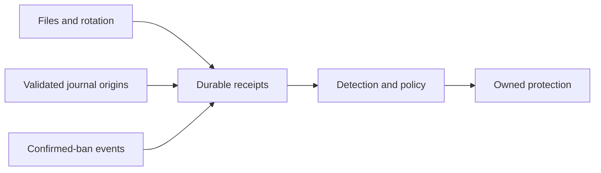

## Sources feed durable records

File, journal and internal events enter native ingestion. A complete record gets
a durable receipt; detection, retries, source progress and effect intent are
committed consistently. Source acknowledgement follows commit. A restart must not
turn a retry into a new event with a new deadline.



## File input

Set `source = "file"`, absolute `logpath` entries and an explicit timestamp
contract for the actual log format. Available contracts are `iso8601`, `syslog`,
`epoch_seconds`, `common_log` and `undated`; use timezone settings when required.
Undated input is an explicit choice, not permission to treat arbitrary malformed
dates as current events.

Checkpoints retain identity and exact saved position across restart and rotation.
Lost continuity, unsafe replay and incompatible source generations require visible
recovery/intervention; the daemon does not invent a position to appear healthy.
Since 0.4.8 a missing, truncated, replaced and rotated file are told apart: a
missing log is a healthy `missing (FileNotFound)` state in `jails`, while
truncation and replacement follow the jail's `on_truncation` policy. The
[log file lifecycle](../guides/log-lifecycle.md) describes each case. Validate
actual read/search permissions under the service identity.

### Malformed file encoding

Starting in 0.4.3, file ingestion replaces invalid encoding bytes and continues
processing, preserving source progress and reporting replacements. This prevents
malformed encoding from stalling affected file ingestion. It does not relax the
selected timestamp contract or turn every repaired line into a matching event.
Journal input retains strict encoding handling.

Native state is at schema 28 in 0.4.9; older binaries refuse it. See
[the upgrade guide](../guides/upgrading.md) before changing versions.

PortSentry uses the dedicated history-file contract with `timestamp = "iso8601"`;
follow the [qualified recipe](../guides/portsentry.md).

## Journal input

Journal input uses journald and the journalctl executable. The source validates
local machine identity, root UID, transport and trusted root-owned executable paths
before admitting a detection. A client-controlled journal tag is not an authorization
signal.

```toml
[jails.sshd]
filter = "sshd"
source = "journald"
journal_executables = ["/usr/sbin/sshd", "/usr/lib/openssh/sshd-session"]
```

An explicit list is an exact origin profile. When it is omitted for a built-in SSH
jail, fail2zig 0.4.1 and later discover available executables from a bounded catalog
of standard SSH paths, verifying ownership, permissions and supported symlinks.
Custom journal rules still require an explicit nonempty profile. Check the executable
locations and origin policy for your host. Native journal progress is durable. This
differs from importing fail2ban state: fail2ban has no saved journal cursor to
transfer, so that migration requires a disclosed reset/replay boundary.

## Internal recidive

```toml
[jails.recidive]
filter = "recidive"
source = "internal"
maxretry = 2
findtime = "1d"
bantime = "1w"
```

Recidive consumes confirmed bans from other jails through the internal source.
It needs no log file, journal selector or custom rule file. A policy decision or
log-only would-ban is not confirmation of installed protection.

## Source selection and health

`source = "auto"` resolves the configured input at startup: it picks the journal
only for the `sshd` filter, when no configured `logpath` exists and
`/usr/bin/journalctl` is present, and a file source otherwise. Prefer an explicit
source for a reviewed deployment. The deprecated fail2ban `backend` alias names a
source; `global.firewall` separately chooses enforcement.

```bash
fail2zig jails
fail2zig status
```

Inspect source health, storage and readiness, not just whether the process exists.
Storage failure pauses affected ingestion while retaining protection. Recovery
must restore the store and verify source continuity before healthy admission.
See [migration continuity](../guides/migration-from-fail2ban.md#continuity-and-replay).
