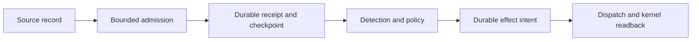

## What the limits mean

fail2zig bounds native ingestion, detection, retries, storage and administration.
It does not promise a whole-process RSS ceiling or zero allocation throughout
the daemon. Zig allocation checks, SQLite's separate heap and kernel/process
resources have different accounting boundaries.

The old tracker-only model is not the native runtime's durability contract.
Critical receipts, active protection owners and unresolved enforcement intent
are not evicted merely to make room for new traffic.

## Admission before work

Startup builds a resource plan and refuses configurations that cannot fit their
native memory or descriptor budgets. The default plan admits at most 64 enabled
jails and eight file incarnations per jail. All jails share one tracking pool of
65,536 tracked addresses and 65,536 live bans; a live ban holds no tracking entry.
When the pool is full the oldest idle tracked address makes room; live bans are
never evicted, and a jail that reaches a limit reports `waiting (RetryCapacity)`
and resumes as room frees. Rule programs also have explicit input and work limits.

| Configuration              | Default | Boundary                                                                                |
| -------------------------- | ------- | --------------------------------------------------------------------------------------- |
| `memory_ceiling_mb`        | 64      | Accepted and range-checked, minimum 16; no admission or runtime check reads it.         |
| `native_memory_ceiling_mb` | 512     | Native admission budget; the 65,536-ban plan is about 337 MiB with two enforcing jails. |
| `native_fd_ceiling`        | 8192    | Descriptor admission budget; at start the soft open-file limit is raised toward it, never past the hard limit. |

SQLite has its own bounded heap of 64 MiB, counted in the admission figure, with
a 32 MiB page cache inside it. Stored retry rows are bounded at the tracking limit
plus 65,536, which is 131,072 by default.

Adding sources or native rules can change the admitted plan. A syntactically valid
configuration can still fail runtime admission; inspect the reported cause rather
than raising every limit without understanding the workload.

## Durable state is part of the budget

SQLite stores complete record receipts, source checkpoints, retry state, policy,
protection ownership, effect intent and confirmed history. Database pages and the
SQLite heap are bounded separately from Zig-owned allocations. Retention can
reclaim eligible history while required recovery anchors remain pinned.

The state file may grow to 1 GiB; a file already past that size is refused at
start. It never shrinks: rows removed by retention free pages for reuse inside it.
`status` shows the size and page use against the ceiling.

Source acknowledgement and in-memory publication follow the relevant commit.
Original event and receipt times survive retries and restart, so retry does not
invent a fresh observation window or extend an existing deadline.

## Exhaustion and recovery

When required storage fails, affected ingestion pauses and health becomes degraded.
Existing protection is retained; the administrative surface remains available to
report the cause. Capacity pressure must not silently discard unresolved effects
or active owners.

Corrupt or incompatible state is refused at startup. Do not delete the database
or its sidecars to suppress a failure. Repair access or restore coherent state,
then verify ownership and source continuity before considering the daemon healthy.
See [upgrade and recovery guidance](../guides/upgrading.md).

## Measure the complete deployment

Use OS process metrics alongside `fail2zig status` and readiness. Include SQLite,
source count, journalctl children, backend helpers, database size and descriptor
use in a workload review. A parser microbenchmark cannot establish daemon memory,
end-to-end throughput or latency under storage pressure.

Release qualification supplies bounded-component and recovery evidence,
not a new comparative performance benchmark. The
[architecture document](../architecture.md)
defines the release's resource boundary.
