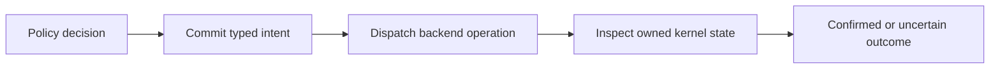

## From intent to installed protection

A ban decision is not yet installed protection. fail2zig commits typed effect intent
before dispatch, performs the backend operation outside the record transaction,
then confirms the result against the owned kernel state. Pending bans are installed
in batches on every backend. Uncertain outcomes remain visible and are reconciled
instead of being reported as successful bans.

Multiple jails can own protection for the same subject. Expiring or removing one
owner must not release another owner's protection. Durable ownership and original
deadlines survive restart and recovery.

## nftables through netlink

The nftables backend constructs structured messages for Linux nf_tables directly.
It needs no nft executable or libnftnl. Each install batch is confirmed by the
kernel's acknowledgement, drift is detected from nf_tables change events, and a
full audit of the owned set runs every 60 seconds. A foreign element in the owned
set degrades protection and keeps auditing until the set is clean. ipset and
iptables keep a readback cadence instead of events.

A healthy stop leaves installed rules in the kernel, where every element carries
its timeout; the next start reinstalls live bans in batches and reconciles them
with durable state. `fail2zig firewall withdraw` removes every realized rule and
holds enforcement off until the next start.

Typed scope can include subject/address family, protocol, ports, interface and
target where supported. Unsupported scope is refused; arbitrary action templates
are not executed. A manual network scope requires nftables or ipset. Do not infer
universal action compatibility from the fact that a host supports nftables.

## Observing owned firewall state

`fail2zig firewall show` reads the daemon's latest retained inspection of
fail2zig-owned kernel protection. The query is read-only and does not trigger a
new kernel inspection, repair state or change rules. Native nftables observation
uses the same direct-kernel boundary and works without the `nft` executable.

The command reports a bounded sample in the daemon's current network namespace.
It does not enumerate UFW, firewalld, container rules or another application's
firewall state. `list` describes ban intent and confirmation; `firewall show`
describes a sampled kernel observation. Neither establishes packet reachability
through the full host or network ruleset.

A failed inspection retains the prior observation and marks the latest attempt
failed, so age and attempt state must be considered together. Unavailable data,
an absent installation and an owned installation with zero entries are distinct.
Detailed structural placement is available only for a complete, stable, exactly
verified owned readback. See the
[administration reference](../reference/cli-fail2zig-client.md#firewall-observation)
for commands and pagination limits.

## Backend selection

`[global] firewall` selects the daemon-wide backend. It defaults to `"auto"`.

| Selection  | Behavior                                                                                                    |
| ---------- | ----------------------------------------------------------------------------------------------------------- |
| `auto`     | Reuse the recorded backend for an existing installation; otherwise probe nftables, then ipset and iptables. |
| `nftables` | Use only nftables.                                                                                          |
| `ipset`    | Use only ipset, with both the ipset and iptables host tools under `/usr/sbin`.                              |
| `iptables` | Use only iptables.                                                                                          |

An explicit choice never switches silently to another backend. With existing state,
`auto` also keeps the recorded backend rather than probing a replacement. Failure
to install the selected scaffold does not trigger a fallback either. `auto` also
stops with a permission error when nftables is denied; it does not then try ipset.
The iptables/ipset backends run `/usr/sbin/iptables`, `ip6tables`, `iptables-restore`, `ip6tables-restore`, `iptables-legacy-save`, `ip6tables-legacy-save` and `ipset` with fixed argument arrays and inspect
their effects; they do not invoke shell templates. nftables audits its owned set
every 60 seconds between change events; ipset and iptables read their state back
every 5 seconds, as does nftables when its event subscription fails.

`defaults.enforce` and jail overrides choose enforcing versus log-only policy.
Deprecated `banaction` values `nftables`, `iptables` and `ipset` still mean
enforcement through the selected global backend; `log-only` means observation.
Jails do not select independent backends.

## Failure behavior

`on_no_backend = "fail-closed"` refuses startup when required enforcement cannot
be established. Explicit `"log-only"` allows degraded observation and reports the
cause. All-log-only configurations need no enforcement backend.

During operation, uncertain effects and degraded dependencies remain distinct
from installed bans. Administrative exit classes 4 and 5 mean partial and uncertain,
not success. Storage failure pauses affected admission while retaining protection.

## Privilege and namespace scope

The unit runs under the non-login fail2zig UID with NET_ADMIN, NET_RAW and
DAC_READ_SEARCH. NET_RAW supports the iptables ipset extension and permits raw
IP sockets. HTTP runs in the same process; AF_PACKET is excluded by the unit.

Effects are limited to the current network namespace. Custom namespace selectors
and service overrides that move the daemon between namespaces are unsupported.
Validate actual packet behavior from a controlled external path; kernel
state inspection alone does not test every surrounding routing/firewall rule.

## Release evidence

The 0.4.0 Debian 13 x86_64 baseline covered all three backends. The 0.4.2
observation path received isolated nftables and iptables checks; live ipset
observation and end-to-end packet reachability remain unqualified. The 0.4.8
campaign on `f2z-target` (Debian 13, kernel 6.12, nftables, 8 vCPU, 16 GiB)
measured a cold restart with 65,536 installed bans reaching readiness in 373 s,
idle at 12 % of one core at that size and 3.5 % with 20,000 bans, and a healthy
stop of about one second; these are measurements on that host, not guarantees.
ARM64, ARM and MIPS artifacts have build/static/QEMU smoke evidence, not live
hardware enforcement qualification. See the
[release notes](../../RELEASE_NOTES.md)
and [migration verification](../guides/migration-from-fail2ban.md#verify-protection).
